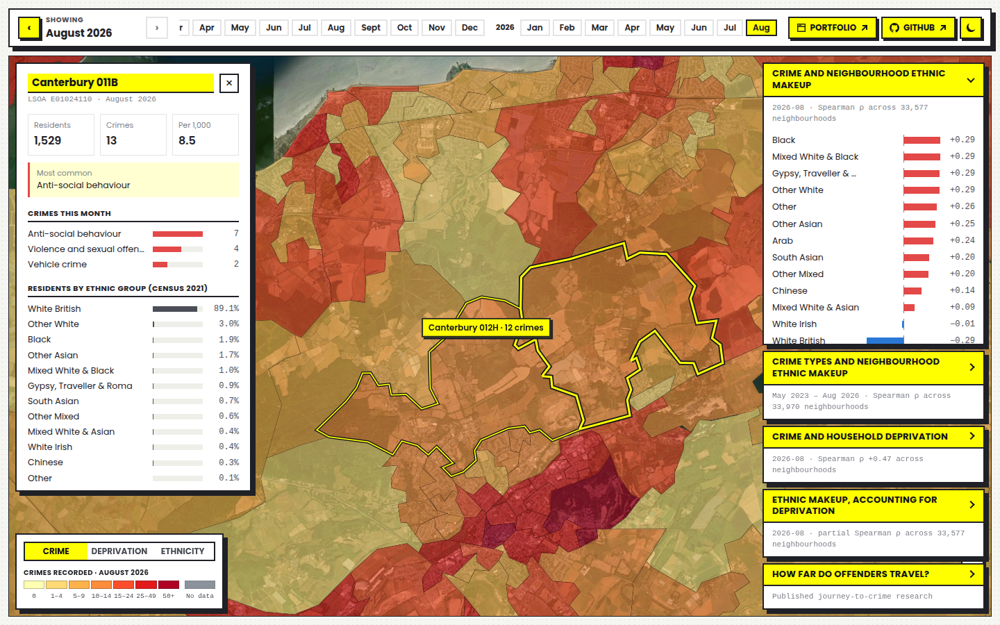

# UK Crime Map

**Live: [uk-crime.gmagellan.dev](https://uk-crime.gmagellan.dev/)**

An interactive map of every street-level crime recorded by the police in England and Wales, month by month, set against the 2021 census: who lives in each neighbourhood and how deprived it is. It updates itself every day when Police.uk publishes a new month.



## Features

- **Crime map of all 35,672 neighbourhoods** (LSOAs) for every month since May 2023, on satellite imagery. Hover for an area's name and value; click for its details (crimes by type, residents by ethnic group, household deprivation).
- **Three map layers:** crime per month, household deprivation, and the share of residents from any one of 13 ethnic groups.
- **Analysis panels**, all computed across every neighbourhood with Spearman rank correlation:
  - crime and neighbourhood ethnic makeup, per month;
  - which crime types go with which ethnic makeup, over all months;
  - crime and household deprivation, with crime per resident in each tenth of neighbourhoods from least to most deprived;
  - ethnic makeup *after accounting for deprivation* (partial correlation);
  - published research on how far offenders travel to commit crimes, with sources.
- **Always current:** a daily GitHub Action checks Police.uk and adds new months automatically.
- **Coverage-aware:** areas whose police force didn't publish a month (e.g. Greater Manchester) are shown as "no data" instead of zero crime, and left out of the statistics.
- **Fast:** WebGL map (MapLibre) with the boundaries tiled in a background worker, so panning and zooming stay smooth with 35k polygons.
- Light and dark mode, phone layout, keyboard access.

> The statistics describe **neighbourhoods, not people**. Crime is recorded where it happens, not where offenders live. See [docs/statistics.md](docs/statistics.md) for a plain-language guide to every number, its limits, and how to check it yourself.

## Data

| Data | Source | Licence |
|---|---|---|
| Street-level crime, by month | [Police.uk](https://data.police.uk/data/) | [Open Government Licence v3.0](https://www.nationalarchives.gov.uk/doc/open-government-licence/version/3/) |
| Ethnic group (TS021) and household deprivation (TS011), Census 2021 | [Office for National Statistics](https://www.ons.gov.uk/census) | Open Government Licence v3.0 |
| LSOA (Dec 2021) boundaries | [ONS Open Geography Portal](https://geoportal.statistics.gov.uk/) | Open Government Licence v3.0 |
| Satellite imagery | Esri World Imagery | Esri terms of use |

Contains public sector information licensed under the Open Government Licence v3.0.

## Tech

- **Front end:** React 19 + TypeScript, Vite, Tailwind CSS 4, MapLibre GL JS
- **Data pipeline:** Node.js scripts (`data_processing/`), checked independently with Python/SciPy
- **Automation:** GitHub Actions (daily data update) → Vercel (deploy on push)

## Project structure

```
front_end/             the web app
  public/data/         processed data the app loads (crime per month, census, boundaries)
  src/components/      map, panels, month bar, area details
  src/data/            loading, coverage and statistics (shared with the data scripts)
data_processing/
  data_raw/            raw downloads (census CSVs, boundaries; monthly crime CSVs are git-ignored)
  scripts/             converters, the daily updater and the verification script
docs/statistics.md     how every number is calculated, in plain language
.github/workflows/     daily crime data update
```

## Running it locally

```bash
cd front_end
npm ci
npm run dev       # http://localhost:5173
npm run build     # type-check and production build into dist/
```

## Updating the data

New months are added **automatically**. The workflow `.github/workflows/update-crime-data.yml` runs daily. It asks the Police.uk API (`/api/crime-last-updated`) for the latest month, and when there's a new one it:
1. downloads `https://data.police.uk/data/archive/latest.zip`;
2. converts the new months;
3. updates which police forces published each month;
4. recomputes the precomputed statistics;
5. commits the result, which triggers the Vercel deploy.

To run the same update by hand:

```bash
cd data_processing && npm ci
npm run update-data              # add any new months (downloads ~1.7 GB only when there are some)
npm run update-data -- --dry-run # just report what would be added
```

Other scripts in `data_processing/` (run with `npm run <name>`, or `node` for the plain ones):
- `correlations`: recompute `crime_group_correlation.json` and `crime_deprivation_correlation.json` from every month.
- `demography`: turn the census ethnic-group table (`data_raw/UK_demography.csv`) into `LSOA_2021_demography.json` (the app's 13 groups per LSOA).
- `deprivation`: turn the census household-deprivation table (`data_raw/LSOA_2021_deprivation_index.csv`) into `LSOA_2021_deprivation.json`.
- `boundaries`: turn the ONS LSOA 2021 boundaries (`data_raw/LSOA_2021_geometry.json`) into `lsoa_boundaries.json` (shapes, drawn by the map) and `lsoa_index.json` (codes, names, bounding boxes).
- `node scripts/crimes_maker.mjs`: full rebuild of every month from the CSVs in `data_raw/crime/<YYYY-MM>/`, if you've downloaded them manually from https://data.police.uk/data/ (all forces, crime data only).
- `python3 scripts/verify_correlations.py`: independent check of the data and statistics with SciPy; see [docs/statistics.md](docs/statistics.md).

## Future ideas

- Map of transport data

## License

MIT
